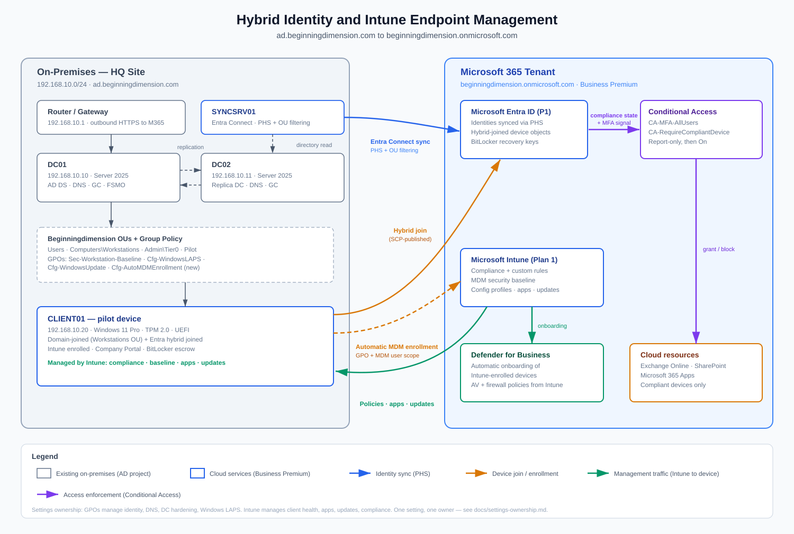

# Hybrid Identity and Intune Modern Endpoint Management

[](https://intune.microsoft.com)
[](https://entra.microsoft.com)
[](https://github.com/microsoftgraph/msgraph-sdk-powershell)
[](https://www.microsoft.com)

> **Portfolio Project:** Production-grade implementation extending an on-premises Active Directory environment (`ad.beginningdimension.com`) into Microsoft Entra ID and Intune. Enforces Zero Trust compliance, automated cloud enrollment, modern app delivery, and Conditional Access gating on an M365 Business Premium footprint.

---

### 🎯 Quick Highlights & Role Fit
* **Target Roles:** Modern Workplace Engineer | Cloud Systems Administrator | Identity & MDM Specialist
* **Key Deliverables:** 20 verified work packages (80% Intune Admin Center / 20% Graph PowerShell & Custom Tooling).
* **Architecture Style:** Hybrid Cloud Identity with Zero Trust Device-Health Enforcement.

---




## 📌 Verified Deployment Proof

| Hybrid Join & Registration | Security, Compliance & BitLocker | App Deployment & Scripts | Zero Trust Conditional Access | Operations & Graph Auditing |
|:---:|:---:|:---:|:---:|:---:|
| **Phase 1** | **Phase 2** | **Phase 3** | **Phase 4** | **Phase 5** |
| `dsregcmd /status`<br>Entra Connect sync<br>Automatic MDM enrollment | Device health attestation<br>Silent BitLocker escrow<br>Custom compliance JSON | Win32 packaging pipeline<br>M365 Apps Click-to-Run<br>Platform inventory logs | Report-only evaluation<br>MFA enforcement<br>Compliant device gates | Graph SDK audit export<br>Automated device sync<br>Bulk group assignment |
| [📁 View Phase 1 Artifacts](docs/assets/Screenshots/Phase%201/) | [📁 View Phase 2 Artifacts](docs/assets/Screenshots/Phase%202/) | [📁 View Phase 3 Artifacts](docs/assets/Screenshots/Phase%203/E-15/) | [📁 View Phase 4 Artifacts](docs/assets/Screenshots/Phase%204/) | [📁 View Phase 5 Artifacts](docs/assets/Screenshots/Phase%205/E-18/) |

*(All timestamped run outputs, evidence captures, and redaction criteria are tracked against the manifest in [docs/evidence-checklist.md](docs/evidence-checklist.md).)*

## Repository Layout

```
intune-hybrid-endpoint-management/
├── docs/
│   ├── assets/
│   │   ├── Screenshots/
│   │   │   ├── Phase 1/
│   │   │   ├── Phase 2/
│   │   │   ├── Phase 3/E-15/
│   │   │   ├── Phase 4/
│   │   │   └── Phase 5/E-18/
│   │   ├── lab-diagram.png
│   │   └── lab-diagram.svg
│   ├── architecture.md
│   ├── environment-and-assumptions.md
│   ├── evidence-checklist.md
│   ├── implementation-ledger.md
│   ├── settings-ownership.md
│   ├── step-by-step-guide.md
│   └── verification-manifest.md
├── scripts/
├── tests/
├── .gitignore
├── README.md
└── validation-and-troubleshooting.md
```

---

## Business Case

The starting point is a working AD deployment: two domain controllers, one Windows 11 client, GPO-based hardening, Windows LAPS, and System State backups. What it lacks is what every organization needs next:

- **Remote management.** GPO only reaches devices on the LAN; Intune manages devices wherever they are.
- **Modern provisioning.** No imaging, no domain-join USB rituals — hybrid join and automatic enrollment.
- **Health-based access.** GPO can enforce settings, but it cannot *gate access* on device health. Intune compliance + Conditional Access can.
- **App delivery.** Win32 packaging and click-to-run Office replace manual installs.

The project delivers all four on a Microsoft 365 Business Premium license footprint — the same stack a small business actually buys.

## 🏛️ Key Architectural & Engineering Decisions

Rather than applying default settings, each component was designed around enterprise operational resilience and defense-in-depth:

1. **Identity Boundary Protection (OU Filtering):**
   * *Decision:* Excluded Tier-0/1 Admin OUs, service accounts, and built-in AD containers from Entra Connect sync[cite: 1].
   * *Impact:* Reduces attack surface by keeping privileged on-prem accounts air-gapped from cloud identity compromise.
2. **Resilient Authentication (PHS over PTA):**
   * *Decision:* Deployed Password Hash Synchronization instead of Pass-Through Authentication or Federation[cite: 1].
   * *Impact:* Ensures cloud service availability during on-premises WAN or infrastructure outages[cite: 1].
3. **Escrow-Before-Encrypt BitLocker Policy:**
   * *Decision:* Configured disk encryption to mandate successful recovery key escrow to Entra ID prior to volume encryption initiation[cite: 1].
   * *Impact:* Guarantees enterprise recovery capability and prevents orphaned, unrecoverable endpoints.
4. **Zero-Lockout Conditional Access Rollout:**
   * *Decision:* Configured emergency cloud-only break-glass accounts with explicit CA exclusions and enforced a strict Report-Only validation phase before switching to block mode[cite: 1].
   * *Impact:* Precludes administrative tenant lockouts while proving policy evaluation telemetry.

## Architecture Overview

| Layer | On-premises (existing) | Cloud (this project) |
|---|---|---|
| Identity | AD DS on DC01/DC02, Kerberos, Windows LAPS | Entra ID via Entra Connect (PHS + OU filtering), Conditional Access |
| Devices | Domain join via GPO | Microsoft Entra hybrid join + automatic MDM enrollment to Intune |
| Policy | GPO baselines (`Sec-Workstation-Baseline`, `Cfg-WindowsUpdate`) | Intune compliance, MDM security baseline, endpoint security, Settings Catalog |
| Apps | Manual / GPO installs | Microsoft 365 Apps suite, Win32 app, platform script |
| Enforcement | Perimeter + GPO | Zero Trust: MFA + compliant-device gates |

Full component breakdown and the Zero Trust flow: [docs/architecture.md](docs/architecture.md).

## Deployment Workflow

```text
Phase 1  Foundation     Tenant/licensing/UPN prep -> Entra Connect (PHS, OU filter) -> hybrid join (SCP)
Phase 2  Enrollment     Automatic MDM enrollment (MDM scope + GPO) -> dynamic groups -> pilot device enrolled
Phase 3  Security       Compliance policy -> custom compliance -> MDM baseline -> Defender -> BitLocker
Phase 4  Configuration  Device restrictions + Settings Catalog -> update rings
Phase 5  Apps           M365 Apps suite + Win32 app (packaged with PowerShell) + platform script
Phase 6  Enforcement    Conditional Access (report-only -> on): MFA + compliant device
Phase 7  Operations     Graph reporting, troubleshooting
````

The exhaustive, click-by-click procedure is [docs/step-by-step-guide.md](docs/step-by-step-guide.md) — 20 Intune work packages plus foundation prerequisites.

## Implementation Ratio: Intune Admin Center /  PowerShell

The Intune implementation is split so the ratio is auditable, not claimed — see [docs/implementation-ledger.md](docs/implementation-ledger.md) for the counting rules:

- **16 work packages ** are configured in the **Microsoft Intune admin center** (its Conditional Access node included) — enrollment, compliance, custom compliance, security baseline, endpoint security (antivirus/firewall), BitLocker, configuration profiles, update rings, apps, and Conditional Access.
- **4 work packages ** are PowerShell: one local packaging script (wrapping the Microsoft Win32 content prep tool), one Graph PowerShell SDK reporting script, and two scripts that execute on managed devices through Intune's platform-script and custom-compliance features.

| Script | Where it runs | Purpose |
|---|---|---|
| [New-Win32Package.ps1](scripts/New-Win32Package.ps1) | Admin workstation | Wrap `IntuneWinAppUtil.exe` with validation, logging, and MSI product-code extraction |
| [Get-IntuneComplianceReport.ps1](scripts/Get-IntuneComplianceReport.ps1) | Admin workstation | Export every managed device's compliance state to CSV via Graph |
| [Get-DeviceInventory.ps1](scripts/Get-DeviceInventory.ps1) | Managed device (platform script) | Inventory snapshot with exit codes reported to Intune |
| [Test-CustomCompliance.ps1](scripts/Test-CustomCompliance.ps1) + [custom-compliance-rules.json](scripts/custom-compliance-rules.json) | Managed device (custom compliance) | RDP/SMBv1 discovery with fail-safe JSON rules |

Tenant setup, Entra Connect, hybrid join, the Defender for Business portal connection, the enrollment GPO, and dynamic groups are **foundation prerequisites **. The four PowerShell packages (P1-P4 in the ledger: sections 17, 18, 15c, and 9) are all mandatory. 
## Security and Compliance Objectives

1. **Every managed device is measured** — BitLocker, Secure Boot, code integrity, firewall, antivirus, OS build floor — and the measurement is enforced at sign-in, not just reported.
2. **Access requires health** — Conditional Access policies deny cloud access from non-compliant or unmanaged devices; MFA is universal.
3. **Least privilege at the boundary** — only the `Beginningdimension` OU tree syncs to Entra ID; Tier-0 admin OUs and service accounts stay on-prem.
4. **One setting, one owner** — the [settings-ownership matrix](docs/settings-ownership.md) prevents GPO/Intune conflicts instead of discovering them in production.
5. **Recoverable encryption** — BitLocker keys escrow to Entra ID before encryption starts; LAPS continues to guard the local admin password.

## Skills Demonstrated

| Area | Evidence in this repo |
|---|---|
| Hybrid identity | Entra Connect with PHS and OU filtering; SCP-based hybrid join |
| Intune administration | Enrollment, compliance, baselines, endpoint security, configuration, updates |
| App engineering | Win32 packaging pipeline with detection rules; M365 Apps XML configuration |
| Automation | Graph PowerShell SDK: reporting, sync, assignment management |
| Zero Trust | Conditional Access design with report-only rollout and break-glass exclusion |
| Operational readiness | Evidence plan, troubleshooting runbooks, rollback per package |

## Getting Started

If you want to reproduce this environment: start from the AD project (the domain `ad.beginningdimension.com`, DC01/DC02, CLIENT01 as described in [docs/environment-and-assumptions.md](docs/environment-and-assumptions.md)), obtain a Microsoft 365 Business Premium trial, then follow [docs/step-by-step-guide.md](docs/step-by-step-guide.md) top to bottom. Each section lists its prerequisites, the exact clicks, the expected result, the evidence to capture, and the rollback.

## Status

Design complete; every configuration path and setting was checked against Microsoft Learn at authoring time (October 2026) and each one is recorded with its source in [docs/verification-manifest.md](docs/verification-manifest.md) — with one disclosed exception: the current Windows Firewall profile's per-setting GUI labels are not published by Microsoft (Settings Catalog-based), so those fields are prescribed by meaning and confirmed in the admin center at execution. 
